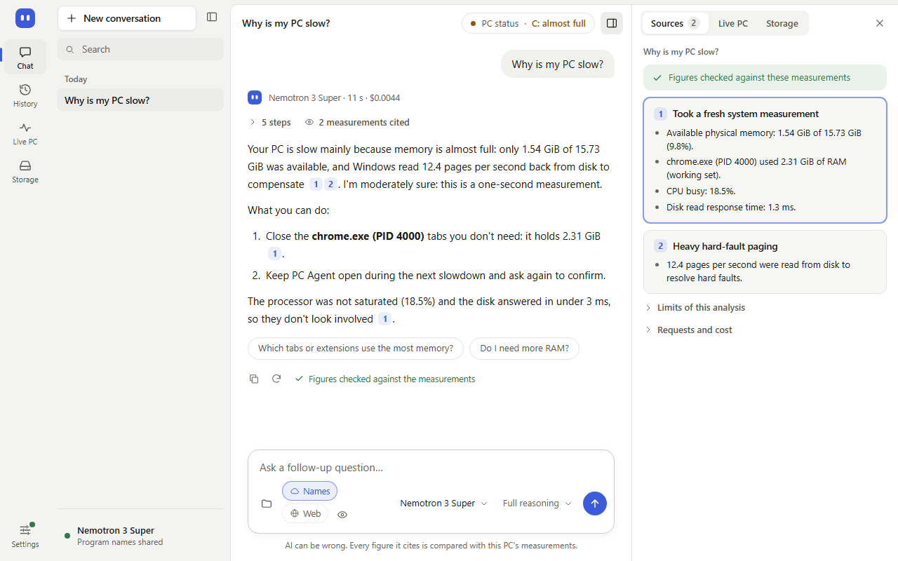
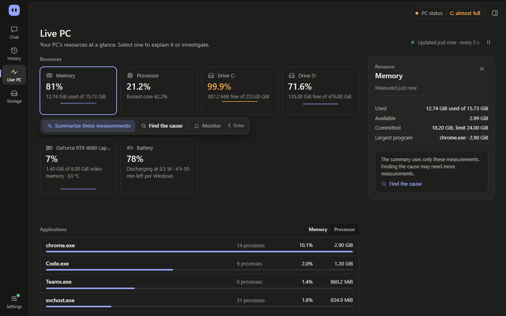
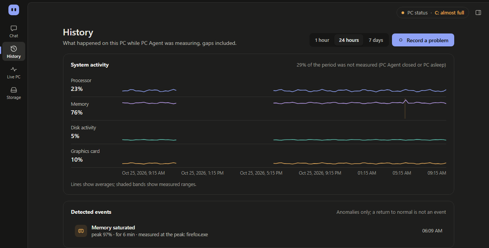
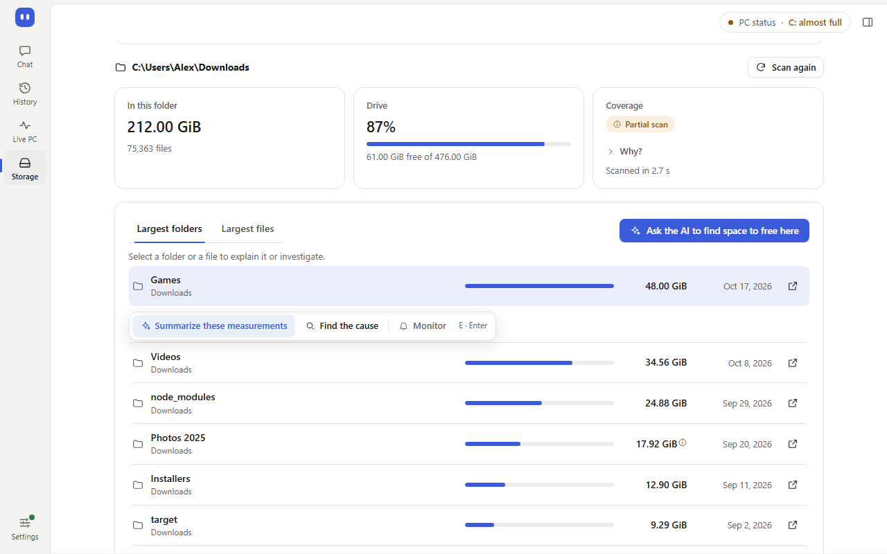
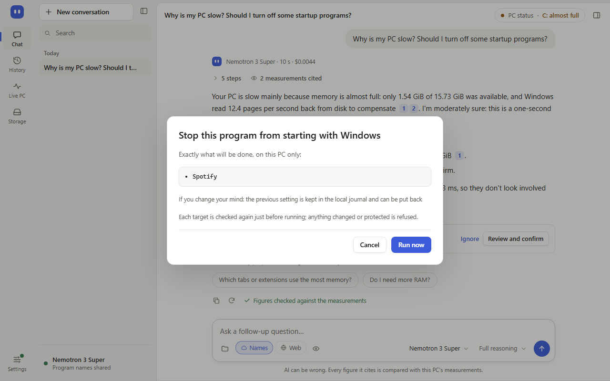
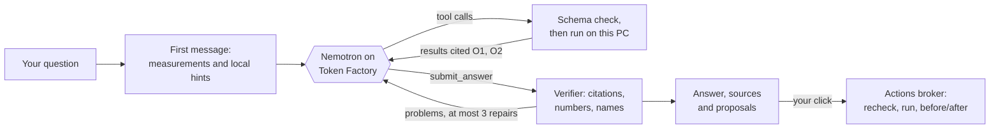

# PC Agent

**Ask why your Windows PC is slow, full or misbehaving, and get an answer you can check.**

PC Agent is a desktop app for Windows 10 and 11 (x64). An NVIDIA Nemotron model, called through
Nebius Token Factory, investigates your PC with about two dozen read-only tools, then writes the
answer. Every figure in the final answer is checked against the measurement it cites, and anything
the model suggests changing runs only after you click.



*All screenshots show the interface running on the design mock's synthetic data, not a real PC.*

This repository is a hackathon submission: an unsigned Windows build without an installer, under
the MIT license. Bring your own Nebius API key, or use the local mode without AI. Jump to
[Install](#install), [For judges](#for-judges),
[How Nemotron is used](#how-nemotron-and-nebius-token-factory-are-used), [Privacy](#privacy) or
[Validation status](#validation-status).

## Why PC Agent

Task Manager shows numbers without explaining them; a chatbot explains without measuring. PC Agent
puts a capable model in front of real measurements, and keeps it honest:

- **The LLM is the analyst.** Nemotron chooses which tools to run, tests its hypotheses, writes
  the answer in the language of your question and handles follow-up questions. Local rules only
  give it hints.
- **The value is in the tools.** Closed-schema tools read memory, processor, disks, graphics cards
  (with NVIDIA's NVML), programs grouped by application, services, startup programs, event logs,
  drivers, Windows Update, batteries, the local history and storage. Each one says what it could
  not read; a missing value is unknown, never zero.
- **Read-only by default.** No tool changes anything. The model can only *propose* an action; it
  runs after your click, and its target is checked again just before.
- **Privacy by visible choice.** Toggles under the question box show what leaves, *See what
  leaves* shows the exact first message before it is sent, and some things never leave at all.
- **No administrator by default.** The app and the model never run elevated. The few readings
  that need administrator rights run in a separate helper, one fixed task at a time, after your
  click and Windows' own prompt; the helper has no network client and no model.
- **Every cited figure is checked.** Each number in an answer must match the measurement it
  cites. What still does not match after the model's corrections is marked as unverified: the
  verifier flags, it never rewrites the answer.

## What it does

### A conversation with cited, verified answers

The interface is in English or French; the model answers in the language of your question. While
it works you see each real step (measuring, listing processes, reading the history…) with its
duration and a Stop button. The answer appears as a draft while Nemotron writes it, then the
checked answer replaces it. Numbered citations open the measurement they cite in the *Sources*
panel. Each answer shows which model wrote it, how long it took, what it cost and whether every
figure was checked, then suggests follow-up questions. Conversations are kept on this PC for 90
days.

### Live PC: Explain and Investigate

Memory, processor, each drive, each graphics card and each battery appear as cards refreshed every
5 seconds, above the programs grouped by application (the WebView2 processes an app starts count
toward that app). Select any item: its details fill the inspector and an action bar appears
under it. *Summarize these measurements* (Explain) answers from the figures already measured,
without collecting anything new; *Find the cause* (Investigate) opens a conversation in which the
model can run its tools. History events, recordings and storage results offer the same two
actions.



### History and recording

While PC Agent runs, it measures the system and its busiest programs every 5 seconds and keeps 7
days on this PC, so "why was it slow around 2 pm?" can be answered from data. The History view
charts processor, memory, disk activity and graphics card over the last hour, 24 hours or 7 days;
periods without measurements stay visible gaps. Anomalies (processor peak, saturated memory, busy
or slow disk) are listed with their peak and duration; processor and memory events also name the
program measured at the peak, which is not presented as the proven cause. *Record a problem*
measures every second for 30, 60 or 120 seconds while you reproduce it. *Start with Windows*, off
by default, keeps the history going from the notification area.



### Storage

Scan a folder (Downloads, Desktop, Documents, TEMP, your profile, the system drive or any folder
you pick) to see its largest folders and files. The scan reads names, sizes and dates only,
follows no links and deletes nothing. Select a result to summarize it or find the cause, or ask
the AI to find space to free in that folder.

Optional administrator readings run in the separate `pcagent-elevated` helper, one at a time,
after you review what it will read, click *Allow and start* and accept Windows' consent prompt:

- **Quick drive analysis** reads the file table (MFT) of a fixed NTFS drive to list its largest
  folders and files: names and sizes, never contents.
- **Deeper checks**: the size of Windows caches (`Windows.old`, downloaded updates, Delivery
  Optimization), the space restore points and shadow copies use, disk health counters
  (temperature, wear, hours powered on, errors), and Windows' own estimates of battery use by app.

When an answer lacked the reading of a deeper check, the chat offers that check under it. Once
you have run a check, the model can read its result for five minutes; it can never start one
itself.



### Actions you approve

The model can propose to show a file in Explorer, open a Windows Settings page (Storage Sense,
Startup apps, Windows Update, optional updates, Power and sleep…), ask a program to close
normally, send files found by a scan to the Recycle Bin, move TEMP files older than seven days or
NVIDIA and Direct3D shader cache files to the Recycle Bin, or stop one of your startup programs
from starting with Windows. Each proposal is a card under the answer saying what it would do and
how to undo it. *Review and confirm* lists every exact target; *Run now* checks each target
again, runs it, and shows the free space or system measurements before and after. A startup
program turned off this way can be restored. In the app, removed files always go to the Recycle
Bin, where they keep taking space until you empty it; nothing runs without your click.



### Optional web lookups

With a [Tavily](https://tavily.com) key and the *Web* toggle on, the model can check four things
no measurement can give: a driver maker's notes for an installed driver, a known issue behind a
Windows update number or stop code, the price of a compatible memory module in your country, and
your PC model's specification sheet. The model never writes the query: PC Agent composes it from
measured references and shows it under the step. Web sources are cited `[W1]`, `[W2]`, are never
treated as measurements of your PC, and their prices and version numbers are checked against the
page excerpt.

### Command line

`pcagent.exe` runs the same core in a terminal: see [Command line](#command-line).

## Install

<!-- TODO(release): link "the GitHub release" below to the published release page (tag v0.1.0), and name its version and commit. -->

1. Download `pcagent-gui.exe` and `pcagent-elevated.exe` from the GitHub release, and keep them
   in the same folder: the app only launches the helper that sits next to it. `pcagent.exe` is
   the optional command line and `pcagent-eval.exe` the evaluation tool
   ([docs/eval.md](docs/eval.md)). There is no installer.
2. The executables are not code-signed, so on first launch Microsoft Defender SmartScreen shows
   *Windows protected your PC*: click **More info**, then **Run anyway**. You can instead open
   each file's Properties and tick **Unblock** before the first launch. For the same reason,
   Windows' consent prompt names an unknown publisher when the helper starts. On a Windows 11 PC
   where Smart App Control is on, Windows may block unsigned apps without offering *Run anyway*;
   that case has not been tested yet.
3. Start `pcagent-gui.exe` normally. PC Agent refuses to run with *Run as administrator* and says
   so.

**Requirements.** Windows 10 or 11, x64, with the Microsoft Edge WebView2 Runtime (included in
Windows 11; on Windows 10, install Microsoft's Evergreen WebView2 Runtime if the window does not
open). Temperature, memory, clock and slowdown details of a graphics card need an NVIDIA GPU and
its driver; other graphics cards report their load only.

**First launch.** A setup guide walks you through:

1. **Open Nebius Token Factory**, which opens `https://tokenfactory.nebius.com/` in your browser,
   to sign in or create an account and an API key;
2. pasting the key into a masked field; it is saved on this PC and never shown again, apart from
   its last four characters;
3. **Load account models**, which lists the Nemotron models your account offers; Nemotron 3 Super
   is the recommended choice;
4. **Test connection**, which confirms that the model is in your account's catalog and, when the
   catalog publishes them, shows its prices per million tokens. These two buttons read the
   account catalog only: no question, measurement or file is sent.

**Continue locally without AI** skips the key: measurements, history, storage and the local rules
keep working, and nothing is sent anywhere. Settings reopens the guide at any time.

<!-- TODO(footprint): memory and processor use of PC Agent (window open, window hidden) and the size of pcagent.sqlite after a known duration, with the date and the PC they were measured on. -->

### For judges

Use your own Nebius key (AI answers are billed to its account, and each answer shows its cost) or
the local mode. Things to try:

- ask one of the suggested questions and click a citation;
- switch *Names* off and open *See what leaves* (the eye icon) before sending;
- in Live PC, select Memory and choose *Summarize these measurements*;
- scan Downloads in Storage and select its largest folder;
- ask what you can clean up, then open *Review and confirm* on a proposal.

### Where your data lives

Everything stays in your Windows profile:

| Location | Content |
| --- | --- |
| `%APPDATA%\pcagent\.env` | Nebius key and model, reasoning setting, optional Tavily key |
| `%APPDATA%\pcagent\privacy.json`, `model-routing.json` | sharing and model choices |
| `%APPDATA%\pcagent\pcagent.sqlite` | conversations (90 days) and measurement history (7 days) |
| `%LOCALAPPDATA%\pcagent\journal` | journal of the actions you ran |
| `%LOCALAPPDATA%\dev.pcagent.desktop` | the window's own WebView data (display preferences) |
| `HKCU\Software\Microsoft\Windows\CurrentVersion\Run`, value `PcAgent` | only while *Start with Windows* is on |

To uninstall, turn off *Start with Windows* (History view or Settings), quit PC Agent from its
notification-area icon, delete the executables, then these folders.

## How Nemotron and Nebius Token Factory are used



- **A tool-calling loop.** PC Agent calls Token Factory's OpenAI-compatible chat completions API
  at `https://api.tokenfactory.nebius.com/v1` with the definitions of its tools and
  `tool_choice: "required"`, so Nemotron acts through tools at every step. It receives a first
  measurement and the local rules' hints, then calls the tools it chooses, several at once if it
  wants. PC Agent validates every call against its closed schema, runs it on the PC and returns
  the result with short citation references (`O1`, `F1`).
- **`submit_answer`.** Nemotron ends a turn by calling `submit_answer` with its answer in
  restricted Markdown, its confidence, a category, the actions it proposes and up to three
  follow-up questions. The verifier checks every citation, number and program name; problems go
  back to the model for at most three corrections, during which the request may name
  `submit_answer` as the only tool.
- **Streaming.** Requests stream, so the app shows the answer as Nemotron writes it, marked as a
  draft, before the checked version replaces it.
- **Reasoning.** Nemotron's thinking is on by default (*Full reasoning*); the question box also
  offers *Light* and *Off*, the latter experimental. Sampling follows NVIDIA's recommended settings
  for Nemotron 3.
- **Budgets.** Per question: at most 10 model requests, 20 tool calls and 600 seconds, and per
  request at most 300 seconds and 8,192 output tokens, reasoning included. At a limit, the app
  asks whether to continue and shows the cost so far, up to three times.
- **Cost per answer.** Measured tokens multiplied by the prices your account's catalog publishes
  (`/v1/models?verbose=true`), shown under every answer. Without a published price, the app shows
  the token usage only; when a request did not report its usage, the cost is shown as a lower
  bound. It never invents a price. Tavily credits are not included.
- **Super and Ultra.** The model picker next to the send button offers Nemotron 3 Super
  (recommended), Nemotron 3 Ultra (more thorough, slower and pricier), Nemotron 3 Nano (cheaper,
  slower) and Nemotron 3.5 Lightning (not recommended); the model must be in your account's
  catalog. The engine can hand a question over from Super to Ultra once, but that automatic mode
  stays off until a reviewed evaluation calibrates it.
- **NVIDIA only.** A model ID must start with `nvidia/`, name Nemotron and appear in your
  account's catalog, which must not list it without tool support. There is no fallback to another
  model or provider. HTTPS is required and redirects are refused.

Implementation details: [architecture](docs/architecture.md#the-agent-loop),
[answer verification](docs/answer-verification.md).

## Privacy

What leaves the PC follows contract C5 of [the plan](docs/plan.md) (in French). You choose the
mode in Settings; the *Names* toggle under the question box switches between the first two.

| Mode | Sent to Nebius for a question |
| --- | --- |
| **Complete** (default) | the question; a first measurement and those the model asks for; program, service and application names; and, when a scanned folder is attached with *File names* on, the names and folder-relative paths of a fixed list of its largest items |
| **Anonymized** | the question and the measurements, with opaque references (`proc-1a2b3c4d`, `file-3`) instead of names |
| **Local** | nothing: answers come from the local rules |

**Never sent, in any mode:** your user name, your profile path, command lines, file contents, keys
and secrets, process IDs, and identifiers of the machine (computer name, serial numbers).

- **The exact message.** *See what leaves* shows the first message of the next question exactly as
  it will be sent; after the turn, its steps keep *Message sent to Nebius* for the session. The
  results of the tools the model then calls follow the same choices. Before sending, the question
  itself is filtered for your user, profile and machine names and for recognizable secrets, but
  no filter can recognize every secret: do not type one.
- **Tavily** is a separate recipient, used only with its own key and the *Web* toggle (on by
  default once a key is saved, never in local mode). A query holds only measured references:
  the driver's provider, device and version, an update number or stop code, the memory type and
  size, the PC maker and model, and your Windows region's country for prices. Never your
  question or text written by the model.
- **Microsoft.** The driver tool reads Windows Update's local cache; only if the model asks for an
  online check does Windows Update contact Microsoft, as Windows itself does.
- **Your browser** opens Nebius Token Factory from the setup guide, and a web source when you
  click *Open in browser*.
- **Keys** are written by the app to `%APPDATA%\pcagent\.env`, a plain-text file protected by your
  Windows profile's permissions (no Windows Credential Manager yet). They never reach the
  window's page, the logs, the previews or the model. A `.env` file in the current folder is
  never read.
- PC Agent sends no analytics or telemetry to its developers. What Nebius and Tavily receive is
  subject to their own terms; this is data minimization, not anonymity.

## Command line

```powershell
pcagent doctor                                      # offline checks of this PC and the setup
pcagent snapshot                                    # memory, processor, disks, GPUs, top processes
pcagent processes --sort-by cpu --limit 10
pcagent storage "$env:USERPROFILE\Downloads" --limit 10
pcagent diagnose "Why is my PC slow?"               # local rules only; nothing is sent
pcagent diagnose "Why is my PC slow?" --preview-cloud   # print the exact first message; send nothing
pcagent diagnose "Why is my PC slow?" --allow-cloud --verbose
pcagent diagnose "What can I clean up?" --allow-cloud --scan-root "$env:USERPROFILE\Downloads" --propose-actions
pcagent chat --allow-cloud                          # several questions in one session
pcagent models --allow-cloud                        # Nemotron models your key can use
```

- Nothing is sent without `--allow-cloud`; `doctor --check-cloud` and `models --allow-cloud` read
  only the model catalog. The key and model come from the environment variables `NEBIUS_API_KEY`
  and `NEBIUS_MODEL_ID`, otherwise from `%APPDATA%\pcagent\.env`, the file the app writes
  ([.env.example](.env.example) lists the settings).
- `--anonymize` sends opaque references instead of program names; `--json` prints machine-readable
  output.
- A proposed action is shown with its real target and runs only if you type `yes` in an
  interactive terminal, never with `--json`.
- Exit codes: `0` the command completed, `2` invalid input or configuration (including an elevated
  session), `3` an interrupted or failed investigation, a failed action or an unavailable
  collection. A completed diagnosis is not a claim that the PC is healthy.

`pcagent --help` lists every command, including history, recordings and the administrator checks.

## Build from source

On Windows 10 or 11 x64, with [rustup](https://rustup.rs), the Visual Studio Build Tools with the
*Desktop development with C++* workload, and WebView2. The repository pins Rust 1.90.0 and commits
`Cargo.lock`; rustup installs the pinned toolchain on first use.

```powershell
cargo build --release --locked -p pcagent-gui -p pcagent-elevated -p pcagent
.\target\release\pcagent-gui.exe
```

The first build compiles Tauri and needs about 3 GB for `target\`. The interface is plain HTML, CSS
and JavaScript modules embedded in the executable, with no Node toolchain. It can also be reviewed
in a browser against synthetic data, without building anything ([desktop app notes](docs/gui.md)).
The workspace is also meant to compile on Linux for its portable tests, with the Windows collectors
reporting *unsupported*; the app itself runs only on Windows.

Checks to run before a change: [validation](docs/validation.md). Rules for contributors and
agents: [AGENTS.md](AGENTS.md).

## Validation status

As of 26 October 2026:

- **Automated.** Formatting, Clippy with warnings denied, the Rust test suite (synthetic data and
  scripted model replies, run under a standard Windows account so the anti-elevation guard is
  exercised) and the release build pass before each merge into `main`. Interface changes are also
  checked with JavaScript logic tests and scripted browser checks in English and French, light and
  dark, at two window sizes. All of this runs locally: the GitHub Actions workflow that ran the
  Rust checks on Windows and Ubuntu has been disabled since 10 October, and the last Linux test run
  recorded in these docs dates from 4 October.
- **On the development PC** (a Windows 11 laptop): native checks of the release app through its
  real bridge (measurements, conversations, sharing previews, Explain and Investigate, history),
  live investigations with Nemotron 3 Super and Ultra, a web lookup answered from NVIDIA's site,
  and the first-launch guide with a real account catalog and connection test.
- **Not yet:** a full test on a second Windows 11 PC installed from the release; an evaluation
  campaign against Claude and ChatGPT on the same situations (the harness exists, scored results
  do not); Windows 10; an acceptance run of the administrator helper's consent prompts; the
  accuracy of the quick drive analysis against a controlled volume.

<!-- TODO(eval): evaluation results (scenarios, scores of Nemotron against Claude and ChatGPT, cost and duration per answer), dated, once the campaign is scored (docs/eval.md). -->

Details and the second-PC checklist: [docs/validation.md](docs/validation.md).

## Limitations

- **Windows only**, x64. Windows 10 is announced but not yet tested.
- **AI answers need your own Nebius key**, billed to its account. The local mode gives the local
  rules' findings, not a written analysis.
- **The model can be wrong.** The verifier checks numbers, names and citations against the
  measurements; it does not prove a cause, and a correlation is not a diagnosis.
- **History exists only while PC Agent runs**, unless *Start with Windows* is on.
- **Coverage.** Disk latency and activity are measured for all disks together, and disk events
  are not attributed to a program. Without an NVIDIA GPU, graphics cards report their load only.
  Every unreadable source is reported as such.
- **Administrator checks** run one at a time, each after its own consent prompt. The quick drive
  analysis lists the largest folders and files it could attribute; its accuracy is not yet
  validated on a controlled volume. The performance trace is not available.
- **Not yet available:** watching a resource against a threshold (the *Monitor* button is shown
  disabled), a cache for web lookups, and Tavily credits in the displayed cost.
- **Interface:** some texts produced by the core, such as findings and coverage notes, stay in
  English in the French interface; screen readers and high-contrast mode are not validated.
- **Distribution:** no installer, no automatic update, no code signing; the keys file is plain text
  protected by your Windows profile.

## Documentation

- [Architecture and safety](docs/architecture.md): crates, trust boundaries, the agent loop, tools,
  the helper and the actions broker.
- [Validation](docs/validation.md): checks, the standard-user test procedure, the second-PC
  checklist and what is not validated.
- [Desktop app](docs/gui.md), [Explain and Investigate](docs/selection.md),
  [answer verification](docs/answer-verification.md), [web lookups](docs/web-search.md),
  [actions](docs/actions.md), [administrator helper](docs/elevation.md),
  [MFT analysis](docs/mft.md), [history storage](docs/history-performance.md),
  [evaluation harness](docs/eval.md).
- [The plan](docs/plan.md), in French: vision, contracts C1 to C7 and the work plan until the
  submission.

## License

MIT, see [LICENSE](LICENSE).
