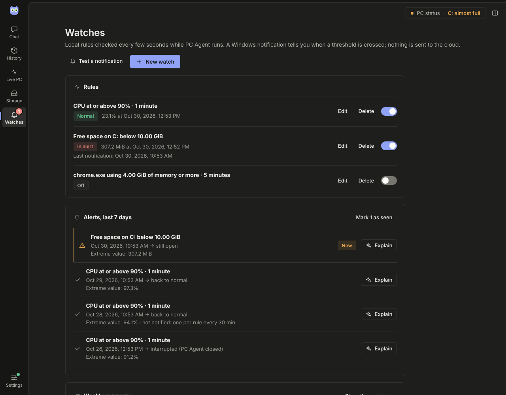
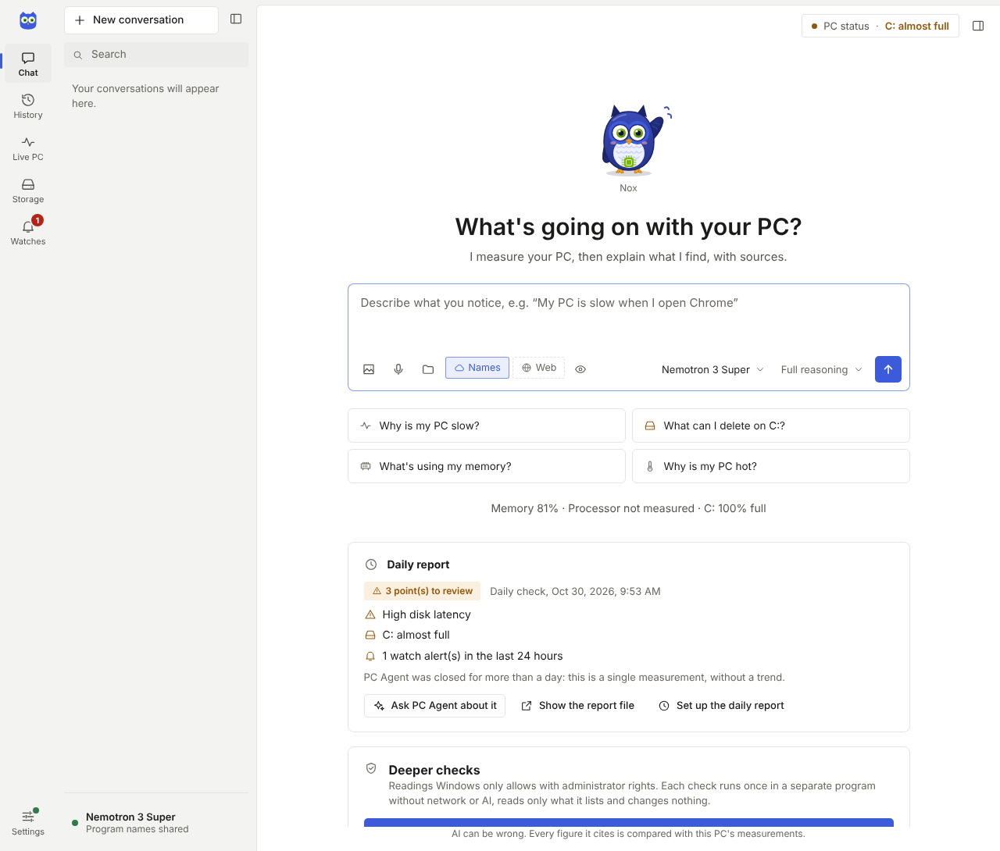
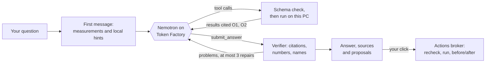
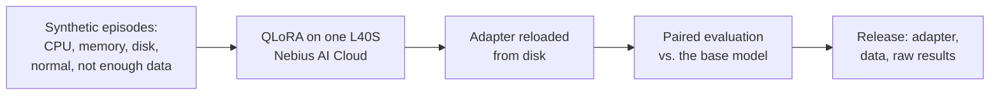

<p align="center"></p>

<h1 align="center">PC Agent</h1>

<p align="center"><b>Ask why your Windows PC is slow, full or misbehaving, and get an answer you can check.</b></p>

<p align="center">
  <a href="LICENSE"></a>
  
  
  
  
</p>

PC Agent is a desktop app for Windows. You describe what you notice ("my PC is slow when I open
Chrome", "what can I delete on C:?"). An **NVIDIA Nemotron** model, served by **Nebius Token
Factory**, then investigates your machine with about two dozen read-only tools and writes the
answer. Every figure in that answer is checked against the measurement it cites. Anything it
suggests changing runs only after you click.


<sub>Screenshots show the interface on the design mock's synthetic data, not a real PC.</sub>

> **Nebius × NVIDIA Global AI Hackathon, *Best Apps and Agents* track.**
> [Quick start](#quick-start) · [For judges](#for-judges) ·
> [Nemotron on Token Factory](#how-pc-agent-uses-nvidia-nemotron-on-nebius-token-factory) ·
> [Fine-tuned Nemotron Nano](#a-nemotron-nano-we-fine-tuned-on-nebius-ai-cloud) ·
> [Tavily](#how-pc-agent-uses-tavily) · [Privacy](#privacy-and-safety) ·
> [Feedback](#feedback-on-token-factory-and-nemotron)

## The problem

Task Manager shows numbers without explaining them. A chatbot explains without measuring, and
happily invents a cause. Most people end up with a "PC cleaner" that deletes things at random,
or a forum thread that may not apply to their machine.

PC Agent pairs a capable reasoning model with real measurements of *your* PC and keeps it
honest:

- **The model is the analyst.** Nemotron decides what to measure, tests its hypotheses, writes
  the answer in your language and handles follow-up questions.
- **The tools are the value.** They read memory, processor, disks, NVIDIA GPUs (NVML), programs
  grouped by application, services, startup programs, event logs, drivers, Windows Update,
  batteries, local history and storage. Each tool says what it could not read; a missing value
  is *unknown*, never zero.
- **Every cited figure is verified.** A number in the answer must match the measurement it cites,
  or the model is asked to fix it. Whatever still does not match is marked as unverified.
- **Read-only by default.** The model can only *propose* an action. It runs after your click,
  and its target is checked again just before.
- **Privacy you can see.** Toggles under the question box decide what leaves the PC, and
  *See what leaves* shows the exact message before it is sent.

## What you can do

### Ask in plain language, get cited answers

Type or dictate a question in English or French. You see each real step (measuring, listing
processes, reading the history…) with its duration and a Stop button. The answer streams in as a
draft while Nemotron writes it, then the verified version replaces it. Numbered citations open
the exact measurement in the *Sources* panel. Each answer shows the model that wrote it, how long
it took, what it cost and whether every figure was checked, then suggests follow-up questions.
Conversations stay on this PC for 90 days.

You can also attach a screenshot of an error message (PNG or JPEG). The question then goes to
Nemotron's vision model, after an exact preview of the prepared image.

### Live PC: Explain and Investigate

Memory, processor, each drive, each graphics card and each battery refresh every 5 seconds, above
the programs grouped by application. Select anything and an action bar appears under it:
- ***Summarize these measurements*** (Explain) answers from the figures already shown, without
  collecting anything new;
- ***Find the cause*** (Investigate) opens a conversation in which the model can run its tools;
- ***Monitor*** creates a watch for that item.


### History and recording

While PC Agent runs, it keeps 7 days of measurements on this PC, so *"why was it slow around
2 pm?"* can be answered from data. Charts cover the last hour, 24 hours or 7 days. Periods
without measurements stay visible as gaps. Detected anomalies (processor peak, saturated memory,
busy or slow disk) name the program measured at the peak, without claiming it is the proven
cause. *Record a problem* measures every second while you reproduce it.


### Watches: be told when something goes wrong

Set a threshold on the processor, memory, disk activity, free space on a drive, an NVIDIA GPU's
temperature or one program's memory or CPU. PC Agent then:
- checks it every few seconds while it runs, in its window or its notification-area icon;
- shows a Windows notification when the threshold is crossed;
- lists each alert with its measured extreme value and an *Explain* button;
- offers a local weekly summary on request.

Nothing is sent anywhere unless you click *Explain*.



### Daily report, even when the app is closed

Turn on the daily report in Settings. Windows then runs a short local check every day at the
time you choose, even if PC Agent is closed: one measurement, the local rules, the last
24 hours of history and alerts, and free space on your drives. The result is a dated report on
this PC, and a notification only when something needs a look. The home page shows the latest
report, answer first, with *Ask PC Agent about it*.

Details: the task runs under your account with the lowest privileges, has a 5-minute limit and
uses no AI and no network.



### Storage, and deeper checks when you allow them

Scan Downloads, Desktop, your profile, the system drive or any folder. Browse the result as a
map, a tree or a list. The scan reads names, sizes and dates only and deletes nothing. Ask the
AI to find space to free in that folder.

Some readings need administrator rights: a fast MFT analysis of a whole NTFS drive, Windows
caches, restore points, disk health and battery use by app. You review the batch of checks and
untick any you don't want. One Windows consent prompt then covers them all, and they run in a
separate helper that has no network access and no AI. The model can propose these checks, but
only you can start them.


### Actions you approve

The model can propose to:
- show a file in Explorer or open a Windows Settings page;
- ask a program to close normally;
- move scan results, old TEMP files or shader caches to the Recycle Bin;
- stop a startup program from starting with Windows.

Each proposal says what it would do and how to undo it. *Run now* checks every target again,
runs it, and shows the free space or measurements before and after.


### Also

- **Local voice dictation**, in English and French, with an offline Whisper model. You review
  the text before sending it; audio is never saved or uploaded.
- **Interface in English or French**, light or dark theme, and Windows high-contrast mode.
- **A command line** (`pcagent.exe`) with the same core: see [Command line](#command-line).

## Quick start

1. **Download** `pcagent-gui.exe` and `pcagent-elevated.exe` from the
   [latest GitHub release](https://github.com/nassim-arifette/pc-agent/releases/latest) and keep
   them in the same folder. Each release lists its commit and SHA-256 checksums. `pcagent.exe` is
   the optional command line.

   > **Release vs. `main`.** Release `v0.1.1` (27 October) predates several features shown
   > here: Watches, the daily report, the single-prompt administrator batch, the Storage map and
   > tree, voice dictation and browser details. Until a newer release is published, these need a
   > [build from source](#build-from-source).
2. **Allow the unsigned app.** The executables are not code-signed, so SmartScreen shows *Windows
   protected your PC*: click **More info**, then **Run anyway**.
3. **Start `pcagent-gui.exe` normally.** PC Agent refuses to run as administrator.
4. **Follow the setup guide:**
   1. open Nebius Token Factory to create an API key;
   2. paste the key (it is stored on this PC and never shown again);
   3. click **Load account models** and pick **Nemotron 3 Super** (recommended);
   4. click **Test connection**.

   These steps read only your account's catalog: nothing about your PC is sent.

No key? **Continue locally without AI**: measurements, history, storage, watches, the daily report
and the local rules all keep working, and nothing leaves the PC.

**Requirements:** Windows 10 or 11 x64 with the Microsoft Edge WebView2 Runtime (built into
Windows 11). GPU temperature, memory and slowdown details need an NVIDIA GPU and driver.

## For judges

Bring your own Nebius key: answers are billed to that account, and each one shows its cost. You
can also try everything except the written answers in local mode. A five-minute path:

1. **Ask** *"Why is my PC slow?"*, watch the steps, then click a citation in the answer.
2. **Privacy:** switch *Names* off and open *See what leaves* (eye icon) before sending.
3. **Live PC:** select Memory, then *Summarize these measurements*, then *Monitor* to create a
   watch.
4. **Storage:** scan Downloads, select the largest folder, and ask what you can clean up.
5. **Actions:** open *Review and confirm* on a proposal to see the exact target and how to undo
   it.
6. **Settings:** turn on the daily report, then *Write a report now*.
7. **Web lookups (optional):** save a Tavily key, keep *Web* on, and ask about a driver or a
   Windows update.

## How PC Agent uses NVIDIA Nemotron on Nebius Token Factory

Nemotron is the brain of the product, not a summary layer on top of rules. Every AI answer is a
multi-step tool-calling investigation running on Token Factory.



- **Tool-calling agent loop.** PC Agent calls Token Factory's OpenAI-compatible chat completions
  API (`https://api.tokenfactory.nebius.com/v1`) with closed-schema tool definitions and
  `tool_choice: "required"`. Nemotron acts through tools at every step, often several in
  parallel. Each call is validated against its schema, run on the PC, and returned with short
  citation references (`O1`, `F1`).
- **Structured final answer.** Nemotron ends a turn with `submit_answer`, which holds:
  - the answer in restricted Markdown;
  - its confidence and a category;
  - the actions it proposes;
  - up to three follow-up questions.

  The verifier checks every citation, number and program name. Problems go back to the model
  for at most three repairs, and repair requests may force `submit_answer` as the only tool.
- **The right Nemotron for the job.** This follows the track's own advice: Super or Nano for
  everyday calls, Ultra when serious reasoning is needed.

  | Model | Use in PC Agent |
  | --- | --- |
  | **Nemotron 3 Super** | default: fast, capable tool use at a low price |
  | **Nemotron 3 Ultra** | deeper investigations; the engine can hand a hard question from Super to Ultra once |
  | **Nemotron 3 Nano** | cheapest option; slower in our tests |
  | **Nemotron 3.5 Super VL** | questions with an attached screenshot |
  | **Nemotron Nano 4B, fine-tuned by us** | experimental next-measure specialist, trained on Nebius AI Cloud ([below](#a-nemotron-nano-we-fine-tuned-on-nebius-ai-cloud)); optional, runs on your PC before the analyst |

  The picker lists only the models your account's catalog offers. The automatic Super → Ultra
  hand-over stays off until a reviewed evaluation calibrates it.
- **Streaming and reasoning.** Answers stream while Nemotron writes them. Its thinking is on by
  default (*Full reasoning*), with *Light* and *Off* in the composer. Sampling follows NVIDIA's
  recommended settings for Nemotron 3.
- **Real cost, from the catalog.** Measured tokens are multiplied by the prices your account
  publishes (`/v1/models?verbose=true`) and shown under every answer. Without a published price,
  only token usage is shown; a missing usage report makes the cost a lower bound. The app never
  invents a price.
- **Budgets.** Per question: at most 10 model requests, 20 tool calls and 600 s. Per request:
  300 s and 8,192 output tokens. At a limit, the app asks whether to continue and shows the cost
  so far.
- **NVIDIA models only.** A model ID must start with `nvidia/`, name Nemotron and be in your
  catalog with tool support. There is no silent fallback to another model or provider.

**Where Token Factory sped up our work**
- **One key, every Nemotron.** A single key and an OpenAI-compatible endpoint gave us Nano,
  Super, Ultra and the vision model, so changing models is a one-line choice in the app.
- **The verbose catalog** gives prices, context sizes and capabilities. It drives the model
  picker, the per-answer cost and the "no tools, no listing" rule, with nothing hard-coded.
- **Streaming with tool calls** let us show live progress and close the stream as soon as a
  complete answer arrives.
- **Replayable runs.** The evaluation harness (`pcagent-eval`) records real tool outputs and
  replays them against Super and Ultra, so model comparisons cost model tokens only.

Other Nebius services: **AI Cloud Compute**, to fine-tune a small Nemotron (next section). The
app itself calls only Token Factory: the tools must read the user's own PC, so it runs on the
desktop and calls Token Factory directly.

Implementation details: [architecture](docs/architecture.md#the-agent-loop),
[answer verification](docs/answer-verification.md), [evaluation harness](docs/eval.md).

## A Nemotron Nano we fine-tuned on Nebius AI Cloud

Big models are the analyst; a small one could do the routine first step: "which read-only
measurement should I take next?". We trained that specialist from
[`nvidia/Llama-3.1-Nemotron-Nano-4B-v1.1`](https://huggingface.co/nvidia/Llama-3.1-Nemotron-Nano-4B-v1.1).



- **What it learns.** For each state, the model picks one of these:
  - the next measurement, from a closed, read-only subset of PC Agent's real inspection calls
    with exact allowed arguments;
  - a request for timing;
  - a summary of the evidence for the analyst;
  - a hand-off when coverage is too thin.

  It has no execution, admin or clean-up authority.
- **How it was trained.**
  - **Data:** 420 synthetic training decisions. Scenario parents are split *before* variants,
    so test scenarios never leak into training.
  - **Recipe:** QLoRA with rank 16, two epochs, and completion-only labels.
  - **Run:** one `gpu-l40s-a` instance on Nebius AI Cloud, with a $20 spending target. The
    instance was then stopped and deleted, and the project inventory checked empty.
- **Results** on 60 frozen test decisions from fresh scenarios:

  | | Base Nano 4B | Fine-tuned |
  | --- | --- | --- |
  | Strict decisions | 0/60 | **52/60** |
  | Whole episodes (teacher-forced) | 0/15 | **8/15** |
  | Sequential exact-call replays | 0/15 | **6/15** |
  | Median latency | 2.50 s | 3.45 s |

- **Honest limits:**
  - the data is synthetic and not reviewed by experts, so these are contract-following scores,
    not real-PC diagnostic accuracy;
  - the specialist is slower than the base model;
  - in the app it is **optional and off by default**: when you turn it on in Settings, it runs
    on your PC (loopback only), picks the first read-only measurement, then hands off to the
    Nemotron analyst on Token Factory, which still writes and verifies the answer. Setup:
    [LOCAL.md](experiments/diagnostic-specialist/LOCAL.md).
- **Get it:** the scripts and full method are in
  [`experiments/diagnostic-specialist`](experiments/diagnostic-specialist/README.md). The
  adapter, data, raw generations and checksums are in the
  [experimental release](https://github.com/nassim-arifette/pc-agent/releases/tag/nano4b-specialist-v0.1.0).
  Only the adapter is distributed; the base model's NVIDIA Open Model License and Llama 3.1
  terms apply.

## How PC Agent uses Tavily

Some answers need facts that no measurement of your PC can give. With a [Tavily](https://tavily.com)
key and the *Web* toggle on, the model gets four typed web lookups:

| Lookup | Example |
| --- | --- |
| Driver release notes | the maker's notes for the exact driver version installed |
| Known issues | a Windows update number or stop code seen in the event log |
| Memory prices | a compatible module for your PC, in your country |
| PC specifications | your exact PC model's specification sheet |

What makes the integration trustworthy:
- **The model never writes the query.** PC Agent builds it from measured references (driver
  provider and version, update number, memory type and size, PC maker and model) and shows it
  under the step. Your question and the model's text are never sent to Tavily.
- **Web sources are not measurements.** They are cited separately (`[W1]`, `[W2]`). Prices and
  version numbers in the answer are checked against the page excerpt.
- **Bounded and cached.** A turn makes at most 3 searches. Results are cached on the PC: 24 h for
  prices and driver notes, 7 days for known issues and specifications. A cache hit says so and
  uses no credit.
- **Cost is reported honestly.** Known Tavily credits, cache hits and lookups with unknown usage
  are counted separately; an unknown usage is never shown as free.

Details: [web lookups](docs/web-search.md).

## Privacy and safety

You choose what Nemotron receives, in Settings or with the *Names* toggle under the question box:

| Mode | Sent to Nebius for a question |
| --- | --- |
| **Complete** (default) | the question, measurements, and program, service and application names; with a folder attached and *File names* on, a fixed list of its largest items |
| **Anonymized** | the question and measurements, with opaque references (`proc-1a2b3c4d`) instead of names |
| **Local** | nothing: answers come from the local rules |

**Never sent, in any mode:** your user name, your profile path, command lines, file contents,
keys and secrets, process IDs, and machine identifiers.

- **See what leaves** shows the exact first message before sending. The question itself is
  filtered for your user, profile and machine names and for recognizable secrets.
- **No administrator by default.** The window and the model never run elevated. The
  administrator helper runs only the closed checks you approved, has no network and no model,
  and needs Windows' own consent prompt.
- **Your data stays local:** keys in `%APPDATA%\pcagent\.env`, conversations (90 days),
  history (7 days), watches and reports in `%APPDATA%\pcagent`, and the journal of the actions
  you ran in `%LOCALAPPDATA%\pcagent`.
- PC Agent sends no analytics to its developers. What Nebius and Tavily receive is subject to
  their own terms: this is data minimization, not anonymity.

## Feedback on Token Factory and Nemotron

What we learned building a real agent on Token Factory:
- **What worked well:**
  - Nemotron 3 Super is a reliable tool caller: it runs several tools in parallel, follows
    closed schemas, and answers in the language of the question once the system prompt says so
    explicitly.
  - The OpenAI-compatible API and the verbose catalog meant no special SDK and no hard-coded
    prices.
- **Stream tail.** After a complete tool call, Nemotron sometimes kept generating (tags, then a
  second copy of the answer) for one to three minutes, up to the output limit. We now close the
  stream at the first complete `submit_answer`. The token count, which only arrives at the end
  of the stream, is then lost, so the cost becomes a lower bound.
  - **Suggestion:** report usage earlier, or let a client stop generation explicitly.
- **Latency is dominated by repairs**, not by the first answer. In 8 real questions (median
  94 s), each repair request cost about 40–50 s. Telling the model precisely how to cite in the
  system prompt removed most repairs.
- **Answering too early.** Declaring `submit_answer` only after a first inspection stopped
  Nemotron from answering without measuring, which had cost 31–49 s per question.
- **Catalog gaps.** Capabilities and prices are not always published for every model. A
  documented per-model flag for tool support and vision would make model pickers simpler.

## Command line

`pcagent.exe` runs the same core in a terminal:

```powershell
pcagent doctor                                        # offline checks of this PC and the setup
pcagent snapshot                                      # memory, processor, disks, GPUs, top processes
pcagent storage "$env:USERPROFILE\Downloads" --limit 10
pcagent diagnose "Why is my PC slow?"                 # local rules only; nothing is sent
pcagent diagnose "Why is my PC slow?" --preview-cloud # print the exact first message; send nothing
pcagent diagnose "Why is my PC slow?" --allow-cloud --verbose
pcagent chat --allow-cloud                            # several questions in one session
pcagent models --allow-cloud                          # Nemotron models your key can use
pcagent report                                        # write today's local report
pcagent --language fr doctor                          # French output
```

- Nothing is sent without `--allow-cloud`.
- The key and model come from `NEBIUS_API_KEY` and `NEBIUS_MODEL_ID`, otherwise from the file the
  desktop app writes ([.env.example](.env.example)).
- A proposed action runs only if you type `yes` in an interactive terminal.

`pcagent --help` lists every command.

## Build from source

On Windows 10 or 11 x64, install [rustup](https://rustup.rs), the Visual Studio Build Tools
(*Desktop development with C++*) and WebView2. The repository pins Rust 1.90.0 and commits
`Cargo.lock`.

```powershell
cargo build --release --locked -p pcagent-gui -p pcagent-elevated -p pcagent
.\target\release\pcagent-gui.exe
```

- **Interface:** plain HTML, CSS and JavaScript modules embedded in the executable, with no Node
  build. It can be reviewed in a browser against synthetic data ([desktop app notes](docs/gui.md)).
- **Installer:** a per-user installer can be built as described in
  [docs/installer.md](docs/installer.md); it has not been tested yet.
- **Linux:** the workspace also compiles on Linux for its tests, but the app runs only on Windows.
- **Contributing:** run the checks in [docs/validation.md](docs/validation.md) before a change,
  and see [AGENTS.md](AGENTS.md) for the contributor rules.

## Status and limitations

- **Tested:**
  - formatting, Clippy with warnings denied, the Rust test suite and JavaScript tests on
    synthetic data;
  - a rendered English/French audit of the interface (no English left in the French
    rendering);
  - native runs on Windows 11 with Nemotron 3 Super and Ultra, a web lookup, and the setup guide
    with a real account;
  - a full install from the release on a second Windows 11 PC.
- **Not yet validated on a real PC:**
  - the daily report task and watch notifications;
  - the administrator batch prompt;
  - voice capture;
  - the installer;
  - screen readers, and Windows 10.

  Checklist: [docs/validation.md](docs/validation.md).
- **The model can be wrong.** The verifier checks numbers, names and citations; it does not
  prove a cause.
- **History and watches exist only while PC Agent runs.** The daily report is the exception.
- **Windows only**, x64. AI answers need your own Nebius key.
- **Distribution:** no code signing and no automatic update. The keys file is plain text
  protected by your Windows profile.

## Meet Nox

Nox is PC Agent's detective owl. Owls investigate, see what others miss and keep watch at night,
like the watches and the daily report. Her eyes are NVIDIA green and her chest holds a chip. She
has one pose per feature ([the set](docs/brand/nox/README.md)).


## Documentation

- [Architecture and safety](docs/architecture.md): crates, trust boundaries, the agent loop,
  tools, the helper and the actions broker.
- **Features:**
  - [Explain and Investigate](docs/selection.md), [answer verification](docs/answer-verification.md),
    [web lookups](docs/web-search.md), [actions](docs/actions.md);
  - [watches](docs/watches.md), [daily report](docs/daily-report.md),
    [administrator helper](docs/elevation.md), [voice](docs/voice.md);
  - [history storage](docs/history-performance.md), [accessibility](docs/accessibility.md).
- [Desktop app](docs/gui.md), [validation](docs/validation.md), [evaluation](docs/eval.md),
  [installer](docs/installer.md),
  [fine-tuned Nano specialist](experiments/diagnostic-specialist/README.md).
- [The plan](docs/plan.md), in French: vision, contracts and work plan.

## License

MIT, see [LICENSE](LICENSE).
