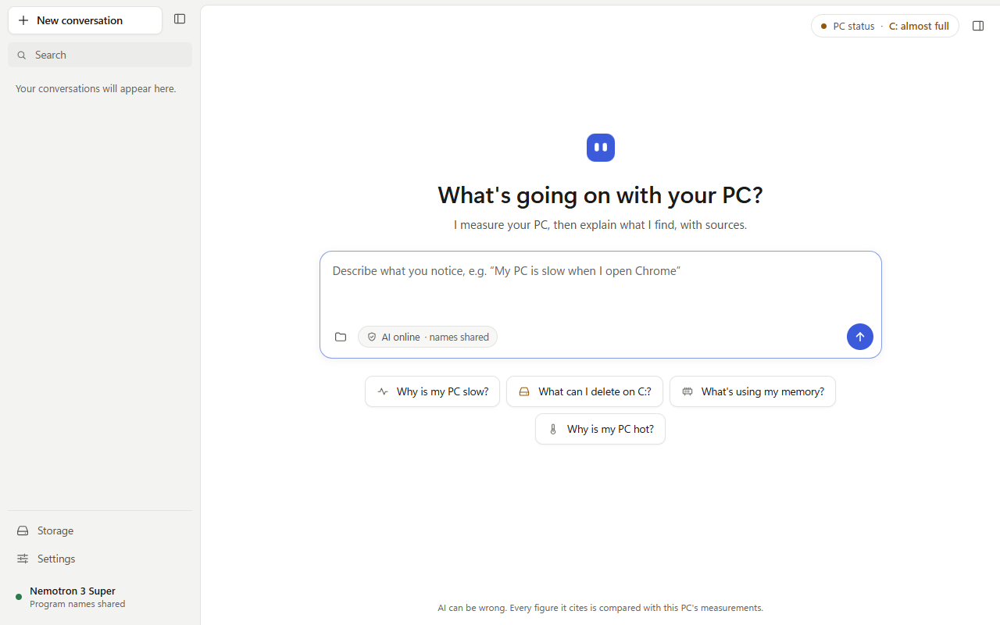
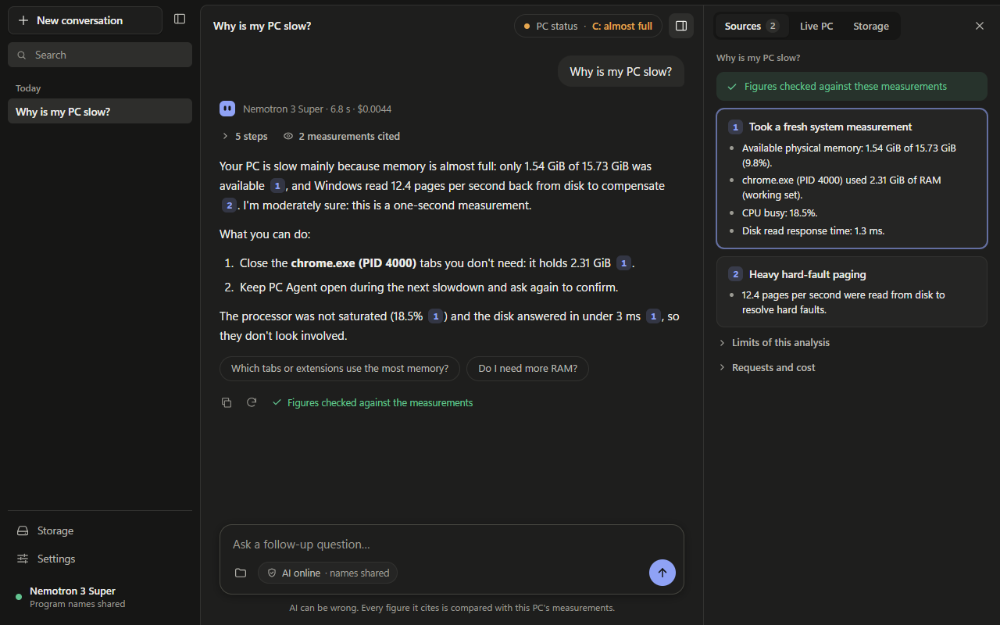

# PC Agent

A Windows investigation agent with a desktop app and a CLI, read-only by default, with locally approved actions. This is an early prototype, not a finished optimizer or a validated hackathon submission. The product direction and the work plan until the submission are in [the October plan](docs/plan.md) (in French); the original [specification v0.1](docs/archive/SPEC_PC_AGENT.md) is archived.

## Implemented in this first slice

| Command | Behavior |
| --- | --- |
| `pcagent snapshot` | System physical memory, system commit, one-second aggregate CPU, disk/GPU engine counters, NVIDIA GPU temperature, memory, clock and slowdown reasons (NVML, when the NVIDIA driver is installed) and top readable process memory contributors. |
| `pcagent processes [--sort-by working_set\|private_commit\|cpu\|io_read\|io_write]` | Local process identities and measurements, ranked before limiting results. CPU/I/O take two observations. |
| `pcagent doctor` | Offline platform/configuration checks. `--check-cloud` explicitly checks the configured model in the Nebius catalog without sending telemetry. |
| `pcagent diagnose "question"` | Local deterministic observations by default. Does not call a model without `--allow-cloud`. |
| `pcagent diagnose "question" --preview-cloud` | Prints the exact first message locally. Sends nothing. Later tool samples may differ. |
| `pcagent storage <folder> [--dirs] [--limit N] [--compare-content]` | Metadata scan with distinct file/folder aliases and local role/application/recovery hints. Optional bounded local content comparison; no deletion or link following. |
| `pcagent diagnose "question" --allow-cloud --verbose` | Bounded Nebius/Nemotron tool loop with local validation and traces of completed inspections. Requires an explicit model ID and API key. |
| `pcagent chat --allow-cloud` | The same investigation, one question after another: each follow-up reads the earlier questions and answers again. Nothing is kept after the session. |

All commands support `--json`. Output marks missing measurements explicitly rather than substituting zero. Non-Windows builds are useful for portable tests but do **not** collect Linux/macOS metrics as though they were Windows measurements.

Scans read metadata only and may run in background workers during an investigation; cancellation and normal shutdown join those workers. Actions require a separate opt-in and a typed local approval. The executable cleanup adapter removes only approved files in a marked synthetic demo cache on Windows/NTFS. There is no elevation, forced process termination, startup modification or automatic cloud request. Interrupted actions are reported from the journal on the next action-enabled run; they are never replayed automatically.

## Desktop app

`pcagent-gui` (`apps/gui`, Tauri 2) runs the same core in a window built around the conversation:
a sidebar with the saved conversations, the thread of questions and written answers, and a context
panel that stays closed until it is needed. A citation chip opens the measurement it refers to, the
*PC status* pill opens live memory, processor, drives and graphics cards, and the storage links open
the last folder analysis. While an investigation runs, each real step appears with its duration and
a Stop button. Every answer says which model wrote it, what it cost and whether its figures were
checked against the measurements. Settings cover the Nebius key and model, theme (light, dark),
language (English, French) and animations.

Each question starts or continues a conversation. A follow-up reads the earlier questions and answers again, then measures afresh. Conversations are kept only on this PC, in `%APPDATA%\pcagent\pcagent.sqlite` next to the settings, for 90 days. They are listed in the sidebar, and they can be deleted one by one or all at once from Settings.

With a usable key and model, questions use the AI by default. Remembered toggles under the composer
control program names, file names from an attached scan, and web search (when its key is configured).
They start enabled; the folder chip can detach a scan. *See what leaves* opens the exact first
message on demand, without a confirmation dialog before sending. Settings also offer local analysis.
Budget extensions still ask for approval, with the cost so far. The key is stored by the Rust side in
the same `%APPDATA%\pcagent\.env` file as the CLI and never reaches the page.




*Screenshots with the design mock's synthetic data.*

```powershell
cargo run --release --locked -p pcagent-gui
```

The first build compiles Tauri (about 3 GB in `target\`). Design, architecture, security and the
browser-based design review are described in [the desktop app notes](docs/gui.md).

## File names and local storage context

Each file and folder has a distinct alias within its scan, linked to an opaque `item_ref`.
The CLI and local JSON restore real paths from the local index. Cloud tools see aliases and
locally computed role/application/recovery hints; a path pattern does not verify ownership,
installation, backup availability or permission to delete.

```powershell
# Local metadata and context; no cloud and no file-content reads.
pcagent storage "$env:USERPROFILE\Downloads" --limit 10
# Explicit local content reads: up to 256 files, 256 MiB and 15 seconds per comparison.
pcagent storage "$env:USERPROFILE\Downloads" --compare-content
# Review useful basenames and representative storage tool payloads; sends nothing.
pcagent diagnose "Quels fichiers examiner ?" --scan-root "$env:USERPROFILE\Downloads" --share-file-names --preview-cloud
# Authorize those categories of data for this run; the actual name list is printed before sending.
pcagent diagnose "Quels fichiers examiner ?" --scan-root "$env:USERPROFILE\Downloads" --share-file-names --allow-cloud
```

`--share-file-names` shares only a frozen list of at most 200 basenames: the largest 20 files
and 20 folders per scope plus ancestors, excluding the root. New scans cannot expand that list.
`--compare-content` is independent and also works with `diagnose --offline --scan-root ...`.
Contents and SHA-256 hashes stay local in every mode. Matches are observations of same-content
copies, with coverage limits, not a deletion recommendation, antivirus scan or corruption check.

`diagnose --scan-root` prepares bounded metadata scans before the investigation, including in
preview/offline mode. Preparation shares 30 seconds and, when enabled, 256 MiB of content reads
across scopes. Limits are cooperative; incomplete coverage stays explicit. See [storage](docs/storage.md).

## Build and run on Windows

Use an x64 Windows development environment with Rust/rustup and the MSVC C++ build tools. The repository pins Rust 1.90.0 and commits Cargo.lock. Builds and CI use that lockfile; CI does not rewrite or push source changes.

```powershell
cargo build --release --locked -p pcagent
.\target\release\pcagent.exe doctor
.\target\release\pcagent.exe snapshot
.\target\release\pcagent.exe processes --limit 10
.\target\release\pcagent.exe diagnose "Pourquoi mon PC rame ?" --offline
.\target\release\pcagent.exe snapshot --json
```

The CI also builds a `pcagent-windows-x64` executable artifact when its Windows job succeeds. It is an unsigned prototype, not an installer or a production release.

Exit codes: `0` = command execution completed, `2` = invalid input/configuration or command error, `3` = interrupted/failed investigation, action failure or unavailable standalone collection. For `diagnose`, inspect `execution_status`, `coverage` and `diagnostic_support` separately: completion may include unavailable sensors or insufficient evidence. Success is not a claim that the machine is healthy.

## Opt-in cloud investigation

No model name is assumed to exist. Obtain an actual NVIDIA Nemotron ID from your Nebius account's `/v1/models` catalog, then set `NEBIUS_MODEL_ID` exactly. The client checks catalog membership and refuses non-NVIDIA/Nemotron IDs; it never silently switches providers or models.

```powershell
# Interactive input keeps the key out of the command history.
$secret = Read-Host "Nebius API key" -AsSecureString
$env:NEBIUS_API_KEY = [System.Net.NetworkCredential]::new("", $secret).Password
$env:NEBIUS_MODEL_ID = Read-Host "Exact NVIDIA Nemotron model ID from your account catalog"

.\target\release\pcagent.exe doctor --check-cloud
.\target\release\pcagent.exe diagnose "Pourquoi mon PC rame ?" --preview-cloud
.\target\release\pcagent.exe diagnose "Pourquoi mon PC rame ?" --allow-cloud --verbose

Remove-Item Env:NEBIUS_API_KEY
```

To avoid setting them in every session, put both values in `%APPDATA%\pcagent\.env`:

```text
NEBIUS_API_KEY=<your key>
NEBIUS_MODEL_ID=nvidia/nemotron-3-super-120b-a12b
```

Only `NEBIUS_API_KEY`, `NEBIUS_MODEL_ID`, `NEBIUS_REASONING` and `TAVILY_API_KEY` are read from that file, and environment variables take precedence over it. A `.env` in the current directory is never read: running pcagent inside someone else's folder must not send your question and measurements to their account. `pcagent doctor` shows where each value comes from.

`--allow-cloud` authorizes this invocation to send the following to Nebius:
- **your question after local filtering of identities and secrets**;
- usable metric values grouped by entity, with their units and observation windows;
- a summary of unmeasured metrics, coverage and limitations;
- opaque process references (`proc-<8 hex>`) and NVIDIA GPU indexes (`gpu-nvidia-0`);
- candidate findings under short aliases (`F1`);
- by default, the **executable name** of each process a payload mentions (for example `chrome.exe`: the last path component only). `--anonymize` keeps processes as opaque references.

Do not put a secret in the question. PIDs, process creation times, boot identifiers, GPU names, full paths, your user name, evidence IDs, source labels and collector session IDs are never sent. This is data minimization, not a claim of anonymity or provider non-retention.

The only endpoint is `https://api.tokenfactory.nebius.com/v1`; HTTPS is required and redirects are disabled. The key stays in the process environment, the credentials file and client memory. The file is plain text protected only by your Windows profile permissions; no credential vault (such as Windows Credential Manager) is implemented yet. Never paste a real key into a repository, issue, terminal recording or chat.

Every cloud diagnosis reports its tokens (input, output, reasoning) per request and an estimated cost: the measured tokens priced at the model's catalog prices, read from `/v1/models?verbose=true` together with the time they were read. Without a price that parses exactly, or with incomplete usage, only the usage is shown (spec 13). `doctor --check-cloud` prints the catalog price. On the development PC on 2026-09-27, 16 diagnoses of eight typical questions with `nvidia/nemotron-3-super-120b-a12b` cost $0.0032 to $0.0134 each (mean $0.0047); the first request weighs 4,500 to 4,800 tokens. [The model comparison](docs/archive/model-comparison.md) keeps Super as the default: Nemotron-3-Nano is 3.4 times cheaper per diagnosis but 4 times slower, with 2 of 8 requests timing out, and Nemotron-3.5-Lightning reached its output limit before choosing a tool in every run. `scripts/compare-models.ps1` reruns the comparison.

## How the first agent works

The local program gathers an overview. The model can request read-only tools from the `Workstation` toolbox (`crates/agent/src/workstation.rs`): `get_system_snapshot`, `get_processes` (`limit` 1-10), `get_process_details` (opaque `entity_ref`), `get_process_tree`, `get_metric_history`, `get_hardware_inventory`, `list_storage_scopes`, `get_storage_overview`, `start_storage_scan`, `get_largest_items`, `get_cleanup_candidates` and `get_user_preferences`. Storage tools only accept opaque scope IDs for folders the user authorized locally with `diagnose --scan-root <PATH>`; each cloud payload is an explicit allowlist (no PIDs, scope roots, full paths or boot IDs; executable names only without `--anonymize`). With `diagnose --allow-cloud --propose-actions`, the model also gets `prepare_action_plan`: it may propose opening an item in Explorer, opening an allowlisted Settings page (`storagesense`, `appsfeatures`, `startupapps`) or running the synthetic cleanup adapter (at most 3 plans). It only receives the plan's model view; after the report, the CLI shows each plan locally with its real target and runs it only if you type `yes` on an interactive terminal (never with `--json`). Execution and approval are never model tools. Moving files to the Recycle Bin stays a recommendation. `pcagent demo-cache --mb 64` creates the marked synthetic cache under `%LOCALAPPDATA%\\pcagent` to demonstrate the adapter. Tools are declared in a local registry (`ToolSpec`/`Toolbox`) with closed argument schemas; unknown keys, wrong types, out-of-range integers and non-opaque references are rejected before any dispatch. The controller executes real collectors, returns minimized observations and records completed tool calls. Model-facing payloads are compact: usable values grouped by entity, each unit once, unmeasured metrics summarized once per reason, and findings without local evidence IDs under per-investigation aliases (`F1`, `F2`, …) that are resolved locally; local finding IDs are never accepted from the model. The local report keeps every field. This cut the first request from about 20,000 to under 5,000 tokens, and the input of eight typical diagnoses by 78%.

The model finishes with `submit_answer`: its own answer, confidence, category, optional prepared action references and follow-up suggestions. The controller verifies immediate observation/finding citations, numeric dimensions and named entities against the actual received measurements. A current claim cannot borrow historical data, another application or another battery; provenance windows and calculation operands are not substitute results. Problems go back to the model for bounded repairs. Any remaining unverified passages stay visible in the report; the verifier does not write the answer. The model remains responsible for reasoning and distinguishing a correlation from a cause.

Each finding follows the spec 8.3 structure: support level (`supported`/`plausible`/`insufficient`, never `supported` from one sample), locally generated facts citing evidence IDs, an optional hypothesis, counter-evidence, missing data, next step and limitations. "No contention observed" is a valid conclusion when all core metrics are measured and moderate. `pcagent_diagnostics::compare` implements the spec 18 before/after verdict (`improved`, `no_net_change`, `regressed`, `not_comparable`, `needs_more_measurement`) and only reports a change when the full before and after ranges do not overlap.

Initial local observation thresholds are below 10% physical memory available, at least 90% of the current commit limit, and at least 90% aggregate CPU in the sample. These are prototype triggers for further investigation, not universal diagnostic rules or validated anomaly thresholds. System commit is not physical RAM occupancy, working sets may share pages, and a short sample cannot establish a memory leak or justify a hardware purchase.

Until a real inspection returns usable observations, requests set `tool_choice: "required"`. Failed tools, preferences, scope listing, scan startup and action proposals do not satisfy that requirement. Fresh comparable measurements supersede older findings, which remain in `historical_findings`; minimized tool results remain available as evidence. The initial budget is ten inference requests, twenty tool calls and 600 seconds, with at most 300 seconds per request and 8,192 output tokens including reasoning. At a limit, an interactive CLI shows the partial report and asks for a typed `yes` to extend the same conversation by that budget, at most three times. Human decision time is excluded; JSON/noninteractive runs never prompt or extend. Failed and truncated requests retain any reported billed usage; missing provider usage remains unknown. The person can stop a turn at any time. A synchronous native call can overrun a deadline.

Reports distinguish `execution_status` (`completed`, `budget_exhausted`, `failed`), `coverage` and `diagnostic_support` (`supported`, `plausible`, `insufficient`). Coverage names system counters, process access, hardware, storage scopes and history windows; uninspected domains remain `not_collected`. Complete coverage requires all reported domains and targets to be complete; it is not a claim to measure every possible PC sensor. Partial pages, inaccessible processes and missing GPU inventory remain visible. The legacy aggregate `status` stays `partial` unless execution, coverage and diagnostic support are all complete/supported. Factual observation citations do not strengthen an unsupported causal diagnosis.

`diagnose --json` emits one document containing the investigation, `actions` (including unexecuted local plan manifests) and `recovery`. It never approves actions. Preferences default to `reversible_only: true`; demonstrating permanent deletion of synthetic data requires an explicit preferences file with `permissions.reversible_only: false` (and `cloud_allowed: true` for cloud diagnosis). `get_processes` also accepts `sort_by` with the same resource names as the CLI.

## Workspace

`pcagent-eval` provides consented local capture, strict replay, and a read-only MCP stdio server
for comparing models against the same recorded situation. Replay is offline by default. See
[the evaluation guide](docs/eval.md) for D: build paths, trace handling, campaigns and grading.

```text
apps/cli/             argument parsing and rendering
apps/gui/             desktop window (Tauri 2): commands and events in Rust, interface in ui/ (docs/gui.md)
apps/eval/            local scenario capture, replay, model traces and MCP stdio (docs/eval.md)
crates/shared/        versioned observations, units, statuses and process identities
crates/telemetry/     read-only Windows adapters; unsupported results elsewhere
crates/diagnostics/   conservative deterministic candidate findings
crates/agent/         minimized cloud envelope, tool registry, bounded orchestration, Nebius transport
crates/storage/       bounded metadata scans and opt-in local content comparison (docs/storage.md)
crates/policy/        protected paths, preferences, cleanup classification and plans (docs/policy.md)
crates/actions/       manifests, local single-use approval, restricted action catalog (docs/actions.md)
```

The CLI and the desktop app have no cleanup or diagnostic business rules; both call the same crates. Unsafe code is isolated to the native Windows adapter; all other crates forbid it.

## Validation

```powershell
cargo fmt --all -- --check
cargo test --workspace --locked
cargo clippy --workspace --all-targets --locked -- -D warnings
```

The GitHub workflow checks formatting, tests and lints on Windows and Linux for pushes and pull requests. Jobs have read-only repository permissions, use no provider credentials and do not upload live telemetry or rewrite the reviewed commit.

The tests cover missing/stale data, large integers, CPU counter regressions, commit-versus-RAM semantics, identity stability, cloud redaction, unknown tool rejection, duplicate call IDs, fabricated findings, resource budgets, provider failures and offline CLI behavior. Scripted provider replies are synthetic test fixtures, not evidence of a live Nemotron integration.

**Not yet validated:** live Nebius/Nemotron tool calling has only been exercised on the development PC (`nvidia/nemotron-3-super-120b-a12b`, 2026-09-27); latency, a representative investigation on a separate Windows 11 PC, diagnostic quality, hardware advice and performance/resource budgets. A hosted Windows CI smoke test is not a substitute for those validations. Check the Actions results for the actual status of compilation/tests; this README does not imply that a pending run has passed.

## Known gaps versus the specification

Action plans are proposed by the model, approved in the CLI and verified according to the effect: actual deleted bytes and volume space for cleanup, system windows for normal close, no performance verdict for Explorer or Settings. Recycle Bin moves are implemented and verified in the actions crate but cannot be proposed by the model yet. Storage investigations can need more than the initial six turns. The interactive extension prompt now continues the same investigation after explicit consent; unattended runs retain a partial report when the budget is exhausted. Disk latency/idle/queue, hard-fault page reads, per-core CPU and GPU engine utilization come from `_Total`/aggregated PDH counters only (no per-device disk attribution, no per-process GPU/disk attribution). NVIDIA GPUs also report temperature, memory, SM clock, power and slowdown reasons through NVML; other GPUs report only engine utilization. No installer is implemented yet, and finding texts stay in English when the desktop app is in French. Web lookups through Tavily (driver notes, known issues, memory prices, the PC's specification sheet) are optional: they need a key and the person's consent, and their queries are composed on the PC ([docs/web-search.md](docs/web-search.md)). `doctor` does not yet validate the Windows build number or storage/database capabilities. Process identities use session-local aliases plus PID and creation time; a true boot identifier is explicitly absent and cross-boot correlation is disabled. Large (>64 logical processor) systems report aggregate CPU as unsupported rather than misreporting one processor group as the whole machine.

JSON byte counts remain exact 64-bit integers in Rust. Future JavaScript/IPC consumers must preserve them as BigInt or a lossless representation; a JavaScript Number is not safe for every value.

See [architecture and safety](docs/architecture.md), [validation checklist](docs/validation.md) and [review status: covered and wanted limitations](docs/archive/review-status.md).

## License

MIT — see [LICENSE](LICENSE).
