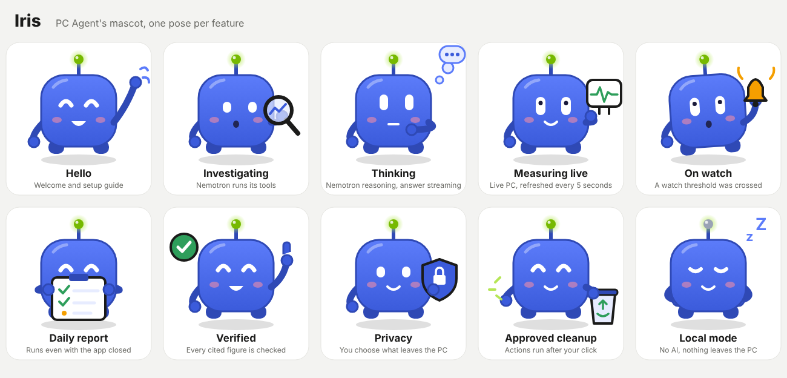

# Iris, PC Agent's mascot

Iris is the brand mark (an *Encre* `#3B5BDB` tile with two capsule eyes, `apps/gui/ui/js/brand.js`)
given a body. Her antenna glows NVIDIA green, a nod to the Nemotron model she speaks for. Each
pose stands for one feature, so she can illustrate the README, the demo video or the
submission page.

| File | Use |
| --- | --- |
| `iris-hello.svg` | welcome, setup guide |
| `iris-investigate.svg` | *Find the cause*: Nemotron runs its tools |
| `iris-thinking.svg` | reasoning, answer streaming |
| `iris-live.svg` | Live PC |
| `iris-watch.svg` | Watches |
| `iris-report.svg` | daily report |
| `iris-verified.svg` | verified figures |
| `iris-privacy.svg` | *See what leaves*, sharing modes |
| `iris-cleanup.svg` | actions you approve |
| `iris-local.svg` | local mode, without AI |
| `iris-poses.svg`, `iris-poses.png` | the whole set |
| `iris-thumbnail.png` | 1024 × 1024 cover (submission thumbnail, video) |

All poses come from one generator, so they share the same proportions:
`node docs/brand/mascot/generate.mjs`. The app itself keeps the calm mark; Iris is for
presenting the project and is not animated in the interface.
