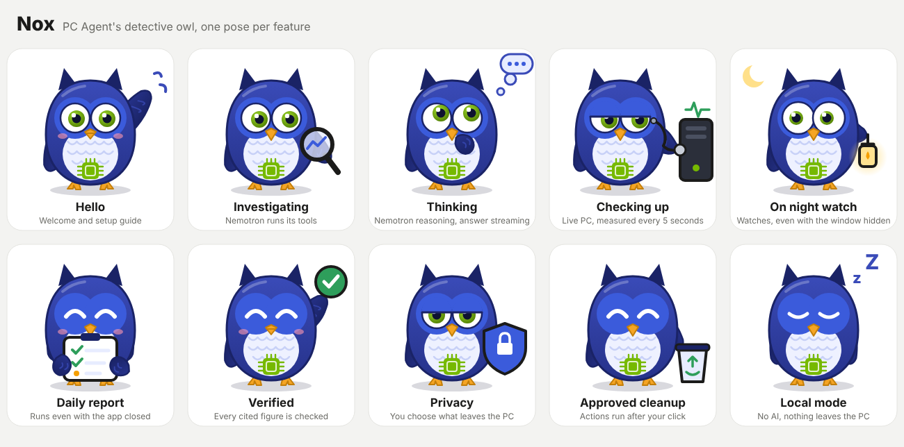

# Nox, PC Agent's mascot

Nox is a detective owl. Owls investigate and see what others miss. They also keep watch at night,
like PC Agent's watches and daily report, which keep working while the window is hidden or
closed. Her eyes are NVIDIA green, a nod to the Nemotron model she speaks for, and a small chip
sits on her chest. Each pose stands for one feature, for the README, the demo video or the
submission page.

| File | Use |
| --- | --- |
| `nox-hello.svg` | welcome, setup guide |
| `nox-investigate.svg` | *Find the cause*: Nemotron runs its tools |
| `nox-thinking.svg` | reasoning, answer streaming |
| `nox-live.svg` | Live PC: a check-up with a stethoscope on the PC |
| `nox-watch.svg` | Watches, on night watch with a lantern |
| `nox-report.svg` | daily report |
| `nox-verified.svg` | verified figures |
| `nox-privacy.svg` | *See what leaves*, sharing modes |
| `nox-cleanup.svg` | actions you approve |
| `nox-local.svg` | local mode, without AI |
| `nox-poses.svg`, `nox-poses.png` | the whole set |
| `nox-thumbnail.png` | 1024 × 1024 cover (submission thumbnail, video) |

All poses come from one generator, so they share the same proportions:
`node docs/brand/nox/generate.mjs`. The app itself keeps its calm two-eyed mark; Nox is for
presenting the project.
