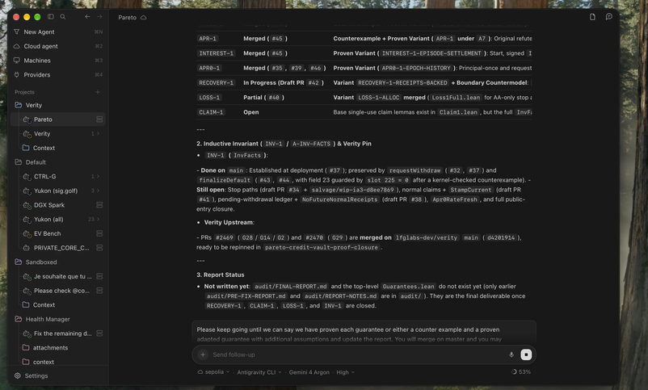

# Orb UI reference — future exploration

Recorded on 26 October 2026 at the project owner's request. This is a design reference,
not an approved implementation or a change to the submission scope.

## Source and screenshots

- Reference project: [Th0rgal/orb](https://github.com/Th0rgal/orb).
- Repository revision observed when recording this note:
  [`8aefff2`](https://github.com/Th0rgal/orb/tree/8aefff29370eca3e8f50615f4850f7327cc8285b).
- Both screenshots below were supplied by the owner. They show **Orb**, not PC Agent.
  Keep them as reference material; do not present them as implemented PC Agent features.

### Overall layout and folders

### Controls below the text input

The owner wants to borrow selected aspects of this style, not copy the entire product.
The most important reference is the compact choice row **underneath** the text input.

## Directions to explore

### 1. Folders and conversation organization

- Group conversations into collapsible folders or projects in the left sidebar.
- Keep the active conversation easy to identify, with a compact hierarchy and restrained
  spacing and icons.
- Decide later whether a folder is only an organizational label or also owns context.
  Grouping a conversation must not silently read files, grant filesystem access or share
  context with a model.

### 2. Connectors — intentionally not selected yet

The owner wants the possibility of connectors but has not chosen which ones. Treat a
connector as an optional way to give PC Agent access to an explicitly selected source or
service. The roadmap does **not** choose integrations, a protocol, accounts or providers.

Before implementation:

- Identify concrete diagnostic use cases and decide what a first connector would read.
- Distinguish a **data/tool connector** from a **model provider**; the Providers entry in
  the reference is not a decision to adopt Orb's provider or subscription infrastructure.
- Define visible permissions, connection/disconnection, credential storage and exactly
  what can leave the PC. Prefer read-only access initially.
- Review any C1–C7 implications separately with the owner before changing the contracts.

### 3. Compact selector row below the composer

- Borrow the placement and density: one quiet horizontal row below the text area,
  small labels, dropdown chevrons and a visible current choice.
- Explore grouping PC Agent's existing model/routing, reasoning and sharing choices there.
  These are candidates, not a finalized set of controls.
- Avoid hiding the sharing mode or the exact-send preview behind ambiguous icons.
- If a usage/context indicator is useful, show only measurements the application actually
  knows. The reference screenshot's percentage is not a specification or a placeholder
  to reproduce.
- Preserve keyboard operation, clear focus states, readable labels and a usable narrow
  window layout.

The subtle surfaces, spacing and typography are additional inspiration. This is not a
request for a pixel-identical clone, a dark-only interface or new execution modes.

## Scope and follow-up

1. Keep these screenshots and this note linked from [the roadmap](plan.md#5-calendrier).
2. In a later design pass, present alternatives for folder organization and the composer
   row, then let the owner select what fits PC Agent.
3. Define the connector use cases before choosing integrations.
4. Only then plan implementation and any required contract changes.

This request records an idea **for later**; it is not a prerequisite for `v0.1.0` and does
not expand the work due before 30 October. If explored during the judging period, changes
belong on `next`, not the frozen submission branch. It does not authorize automatic
context sharing, additional cloud providers or remote execution.

## Possible code reuse

Orb can be studied later for relevant interaction patterns or implementation techniques.
No Orb code, dependencies, credentials, branding or runtime integration is added here.
The two owner-supplied screenshots are retained only as attributed design references.

At the time of this check, GitHub reported no repository license, the root listing contained
no license file and the license endpoint returned 404. This does not establish the licensing
of every individual file. Before copying any code or other assets, verify the license and
notices for the exact files and revision, plus compatibility and attribution requirements;
if permission is unclear, obtain it or implement the interaction independently.
